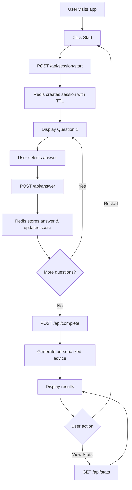

# Mental Well-Being Self-Check Web App 🌟

A supportive, ethical mental well-being self-assessment tool built with **Node.js**, **Express**, **Redis**, and **vanilla JavaScript**. This application demonstrates the power of Redis for session management, real-time scoring, and anonymous statistics tracking.

## 🎯 Features

- **5-Question Assessment**: Evaluate mood, energy, stress, sleep, and motivation
- **Real-time Scoring**: Instant score calculation using Redis counters
- **Personalized Advice**: Rule-based supportive guidance based on responses
- **Session Management**: Automatic session expiration with Redis TTL
- **Anonymous Statistics**: Global aggregated data without storing personal information
- **Premium UI**: Modern glassmorphism design with smooth animations
- **Ethical Design**: Clear disclaimers and non-diagnostic messaging

## 🏗️ Architecture

### Tech Stack

- **Backend**: Node.js + Express
- **Data Store**: Redis (in-memory, ephemeral storage)
- **Frontend**: HTML5, CSS3, Vanilla JavaScript
- **No Database**: All data stored temporarily in Redis

### Why Redis?

Redis is **perfect** for this application because:

1. **⏱️ Automatic TTL (Time-To-Live)**
   - Sessions expire automatically after 30 minutes
   - No manual cleanup required
   - Privacy-first: data doesn't persist indefinitely

2. **⚡ Lightning-Fast Performance**
   - Sub-millisecond response times
   - In-memory storage for instant reads/writes
   - Perfect for real-time scoring

3. **🔢 Atomic Counters**
   - `INCR` and `INCRBY` operations are atomic
   - No race conditions when updating scores
   - Thread-safe score calculations

4. **📊 Efficient Statistics**
   - Hash data structures for question statistics
   - O(1) complexity for most operations
   - Easy aggregation without database overhead

5. **🎯 Simple Key-Value Model**
   - Perfect for ephemeral session data
   - No complex schema needed
   - Easy to understand and maintain

## 📁 Project Structure

```
SQLPsy/
├── backend/
│   ├── server.js           # Express server and API routes
│   ├── redis-client.js     # Redis connection and session helpers
│   ├── questions.js        # Question definitions and scoring
│   └── advice-generator.js # Rule-based advice logic
├── frontend/
│   ├── index.html          # Main application page
│   ├── styles.css          # Premium styling with glassmorphism
│   └── app.js              # Vanilla JavaScript for UI and API calls
├── package.json            # Dependencies
├── .env                    # Environment variables
└── README.md               # This file
```

## 🔑 Redis Key Structure

### Session Keys

```
session:{sessionId}:answers     → Hash: { questionId: answerValue }
session:{sessionId}:score       → String: total score (integer)
session:{sessionId}:metadata    → Hash: { createdAt, status }
```

**TTL**: All session keys expire after 1800 seconds (30 minutes)

### Statistics Keys

```
stats:question:{questionId}     → Hash: { "1": count, "2": count, ... "5": count }
stats:total:sessions            → String: total number of sessions created
```

**TTL**: Statistics keys persist indefinitely (no TTL)

### Example Redis Commands

```bash
# View all session keys
redis-cli KEYS "session:*"

# Get session answers
redis-cli HGETALL "session:1704739200-abc123:answers"

# Get session score
redis-cli GET "session:1704739200-abc123:score"

# Check TTL
redis-cli TTL "session:1704739200-abc123:answers"

# View mood statistics
redis-cli HGETALL "stats:question:mood"

# Get total sessions
redis-cli GET "stats:total:sessions"
```

## 🚀 Setup & Installation

### Prerequisites

- **Node.js** (v14 or higher)
- **Redis** (v6 or higher)

### 1. Install Dependencies

```bash
cd SQLPsy
npm install
```

### 2. Start Redis

**Windows (using Redis for Windows or WSL):**
```bash
redis-server
```

**macOS (using Homebrew):**
```bash
brew services start redis
```

**Linux:**
```bash
sudo systemctl start redis
```

**Docker:**
```bash
docker run -d -p 6379:6379 redis:latest
```

### 3. Configure Environment

The `.env` file is already created with default values:

```env
REDIS_URL=redis://localhost:6379
PORT=3000
SESSION_TTL=1800
```

Modify if needed for your environment.

### 4. Start the Server

```bash
npm start
```

The server will start on `http://localhost:3000`

## 📖 Usage

1. **Open your browser** to `http://localhost:3000`
2. **Read the disclaimer** and click "Start Self-Check"
3. **Answer 5 questions** about your current well-being
4. **Receive personalized advice** based on your responses
5. **View statistics** (optional) to see anonymous aggregated data

## 🔄 Application Flow



## 🛡️ API Endpoints

### `POST /api/session/start`
Create a new session and return session ID.

**Response:**
```json
{
  "success": true,
  "sessionId": "1704739200-abc123",
  "createdAt": "2026-01-08T18:00:00.000Z"
}
```

### `GET /api/questions`
Get all assessment questions.

**Response:**
```json
{
  "success": true,
  "questions": [...]
}
```

### `POST /api/answer`
Submit an answer for a question.

**Request:**
```json
{
  "sessionId": "1704739200-abc123",
  "questionId": "mood",
  "answer": 4
}
```

**Response:**
```json
{
  "success": true,
  "currentScore": 4,
  "answeredQuestions": 1
}
```

### `POST /api/complete`
Complete assessment and get personalized advice.

**Request:**
```json
{
  "sessionId": "1704739200-abc123"
}
```

**Response:**
```json
{
  "success": true,
  "advice": {
    "score": 18,
    "category": "good",
    "categoryLabel": "Good Well-being",
    "mainAdvice": {...},
    "specificTips": [...],
    "resources": [...]
  }
}
```

### `GET /api/stats`
Get anonymous global statistics.

**Response:**
```json
{
  "success": true,
  "stats": {
    "totalSessions": 42,
    "questionStats": {...}
  }
}
```

## 🎨 Design Features

- **Glassmorphism Effects**: Modern frosted glass aesthetic
- **Gradient Backgrounds**: Calming purple and blue gradients
- **Smooth Animations**: Fade-in, scale, and slide transitions
- **Responsive Design**: Mobile-first, works on all devices
- **Dark Theme**: Easy on the eyes, modern appearance
- **Micro-interactions**: Hover effects and button animations

## ⚠️ Important Notes

### Ethical Considerations

- This tool is **not a medical diagnosis**
- Advice is supportive and **non-diagnostic**
- Users are encouraged to seek professional help when needed
- Prominent disclaimers are displayed throughout

### Privacy & Data

- **No personal data** is collected
- Sessions are **ephemeral** (30-minute TTL)
- Statistics are **anonymous** and aggregated
- No user tracking or identification

### Production Considerations

If deploying to production:

1. **Use Redis Cloud** or managed Redis service
2. **Enable HTTPS** for secure connections
3. **Add rate limiting** to prevent abuse
4. **Configure CORS** properly for your domain
5. **Monitor Redis memory** usage
6. **Add error tracking** (e.g., Sentry)
7. **Consider adding authentication** if needed

## 🧪 Testing

### Manual Testing Checklist

- [ ] Session creation works
- [ ] Questions display correctly
- [ ] Answers are stored in Redis
- [ ] Score calculation is accurate
- [ ] Advice is generated based on score
- [ ] Statistics are updated
- [ ] Session expires after TTL
- [ ] UI is responsive on mobile
- [ ] All animations work smoothly

### Redis Verification

```bash
# Monitor Redis commands in real-time
redis-cli MONITOR

# Check memory usage
redis-cli INFO memory

# View all keys
redis-cli KEYS "*"

# Clear all data (for testing)
redis-cli FLUSHALL
```

## 🤝 Contributing

This is a demonstration project. Feel free to:

- Add more questions
- Enhance the advice logic
- Improve the UI/UX
- Add data visualization
- Implement additional features

## 📄 License

MIT License - feel free to use this code for learning and projects.

## 🙏 Acknowledgments

Built to demonstrate:
- Redis session management
- Ethical mental health tool design
- Modern web development practices
- Vanilla JavaScript capabilities

---

**Remember**: This is a self-reflection tool, not a replacement for professional mental health care. If you're struggling, please reach out to a qualified healthcare provider. 💙
